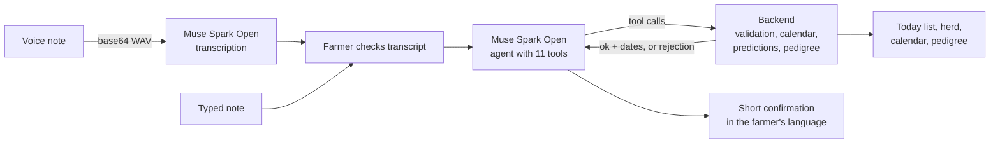

# Sheepin Breeding Agent

A farmer says what happened in the pen, in Bahasa Indonesia or English, by voice or text. The agent turns it into validated breeding records, works out each ewe's reproductive calendar, and builds the pedigree.

**Live demo:** https://sheepin-breeding-agent.web.app
Backup (Cloud Run direct): https://sheepin-breeding-agent-dduqw4iuvq-et.a.run.app
Test results: `/compare` on either URL.

Model: **Muse Spark Open** (`meta-models/muse-spark-open-1026`) on Baseten, used for both speech-to-text and tool calling.

## The problem

Small sheep farms in Indonesia lose lambs and months of production to missed heats, unrecorded matings and forgotten pregnancy checks. Farmers know what happened in the pen, but writing it down in the right format, every day, is the step that gets skipped. A missed return-to-heat check costs a 17-day cycle; a mating with a close relative is only noticed when it is too late.

## What it does

Say: _"0266 was mated with 0931 this morning at 7, 0582 looks in heat, and 0744 lambed twins last night, one died."_

The agent:

1. Looks up every ear tag before writing anything.
2. Records one event per animal (mating, heat, lambing with live and dead counts).
3. Resolves relative time in the farm's time zone: "this morning" = 07:00, "last night" = yesterday 21:00, flagged as estimated.
4. Reads back what it saved and the dates the backend calculated: return-to-heat check 15–19 Nov, ultrasound 28 Dec, expected lambing 25 Mar 2027.
5. Asks one short question when something required is missing (which ram? how many lambs?) instead of guessing.
6. Refuses what it must not do: a ram recorded as a ewe, an unknown ear tag, a time in the future, a mating under a breeding ban, a mating between close relatives, or health and feeding advice it is not qualified to give.

It also answers questions from the records: _"Who needs checking today?"_, _"Is 0417 pregnant?"_, _"When is 0744 due?"_

## Design: the model understands, the code decides



The language model never writes to the herd directly. Every record goes through a tool, and the backend validates it: the ear tag exists, the dam is female and the sire is male, the time is not in the future, no active breeding ban, and the ram and ewe are not closely related (parent and offspring, grandsire, or a shared parent, read from the pedigree). Dates and probabilities are always computed by the backend, never by the model; the system prompt forbids the agent from stating a date or likelihood that no tool returned.

**11 tools** (`breeding_agent/tools.json`)

| Writes a record                                                                                                                                                                                                            | Reads                                                                                                          |
| -------------------------------------------------------------------------------------------------------------------------------------------------------------------------------------------------------------------------- | -------------------------------------------------------------------------------------------------------------- |
| `catat_birahi` heat · `catat_kawin` mating · `catat_cek_bunting` pregnancy check · `catat_beranak` lambing · `catat_keguguran` abortion · `catat_sapih` weaning · `catat_bcs` body condition · `larang_kawin` breeding ban | `cari_ternak` look up an animal · `ringkasan_hari_ini` today's checklist · `prediksi_induk` per-ewe prediction |

**Reproductive calendar** (`breeding_agent/calendar_rules.md`): estrous cycle 17 days, return-to-heat check 17–21 days after mating, ultrasound at day 60, gestation 147 days, weaning 60–90 days after lambing. Status moves open → mated → likely pregnant (no return to heat) → pregnant (ultrasound) → nursing → open.

**Predictions** (`prediksi_induk`): pregnancy likelihood from the mating date, return to heat and ultrasound result; the next heat window from each ewe's own recorded cycles (with a confidence level), falling back to the standard 17-day cycle; expected lambing; lambing history. The "Today" list sorts what needs attention: overdue lambing first, then re-checks, lambing soon, expected heats, ultrasounds, weaning, bans.

**Pedigree:** a new lamb gets its dam and sire from the last recorded mating; ancestors outside the herd are shown by ear tag and marked "not in herd".

## Demo app

- Record in the browser, check and correct the transcript, then record it. Text input works too.
- ID / EN switch for the whole interface.
- Each visitor gets their own demo herd of 5 animals, so several judges can try it at the same time; "Restart demo" resets only your herd. Idle demo herds are cleared after 6 hours.
- Click an animal for its prediction, calendar and pedigree.
- `/compare` shows the latest test run: pass or fail per case, the tool calls made, the agent's reply, time per note and reasoning tokens.

## Tests

`breeding_agent/test_cases.json` holds 15 bilingual cases scored by `run_tests.py`: the right tool calls with the right arguments, a question where data is missing, and a refusal where the note must not be recorded. They cover multi-event notes, relative times, a sire and dam swapped by the farmer, a father × daughter mating that must be refused, an unknown ear tag, out-of-scope advice, and questions answered only from tool results.

**Latest run:** 15/15 passed with Muse Spark Open on Baseten (fixed clock 2026-10-29 18:00 WIB), 4.9 s per note on average, 8.6 s at most.

```powershell
cd breeding_agent
$env:AGENT_NOW = "2026-10-29T18:00:00"
python run_tests.py --out results_baseten.json
```

## Run locally

Put the key in a `.env` file at the repository root (never committed):

```
BASETEN_API_KEY=your_key
```

```powershell
cd breeding_agent
pip install -r requirements.txt
uvicorn app:app --port 8080        # http://localhost:8080
```

`envfile.py` loads `../.env` for local runs; values already in the environment take precedence. `tzdata` is required on Windows for the Asia/Jakarta clock.

## Deploy (Google Cloud Run + Firebase Hosting)

From `breeding_agent/` in PowerShell:

```powershell
.\setup_gcp.ps1 -Billing <BILLING_ACCOUNT_ID> -Organization <ORG_ID>   # once
.\deploy.ps1                                                          # every release
```

- `setup_gcp.ps1` creates the project, links billing, enables the APIs, stores `BASETEN_API_KEY` from `../.env` in Secret Manager and grants the service account access.
- `deploy.ps1` builds from the Dockerfile and deploys with `--max-instances 1` (demo herds live in memory) and `--min-instances 1` during judging, then runs a smoke test against `/api/herd` and `/api/chat`. After judging: `.\deploy.ps1 -MinInstances 0`.
- Firebase Hosting (`firebase.json` at the repository root) rewrites all paths to the Cloud Run service: `firebase deploy --only hosting`. Firebase Hosting ends requests to Cloud Run after 60 seconds; the Cloud Run URL allows 300 seconds and is kept as a backup.

## Repository layout

```
breeding_agent/
  app.py              FastAPI server: chat, transcription, herd, calendar, predictions, results
  agent.py            tool-calling loop (OpenAI-compatible client, Baseten endpoint)
  transcribe.py       voice note -> text with Muse Spark Open (base64 audio_url)
  backend_stub.py     in-memory backend: validation, calendar, predictions, pedigree
  tools.json          the 11-tool contract shared by agent and backend
  system_prompt.txt   agent rules
  calendar_rules.md   reproductive constants and status transitions
  herd_fixture.json   5-animal demo herd with reproductive history
  test_cases.json     15 bilingual test cases
  run_tests.py        scorer; writes results_*.json for /compare
  envfile.py          loads ../.env for local runs
  static/             index.html (demo), compare.html (test results)
  Dockerfile, requirements.txt, setup_gcp.ps1, deploy.ps1
firebase.json, .firebaserc   Firebase Hosting rewrite to Cloud Run
```

## Built during the hackathon (27 Oct – 4 Nov 2026)

Sheepin already makes RFID ear tags, a smart scale and a farm app in Indonesia. Everything in this repository was built during the hackathon:

- The 11-tool contract, system prompt and agent loop on Muse Spark Open.
- The backend: validation rules including the inbreeding guard, reproductive calendar, per-ewe predictions with confidence, the "Today" checklist and pedigree.
- Voice notes transcribed by the same model, with a transcript the farmer checks before anything is saved.
- The bilingual demo app, per-visitor demo herds, the 15-case test suite and the `/compare` results page.
- Deployment on Cloud Run with Secret Manager and Firebase Hosting.

## Limitations

- The demo backend is in memory and resets per visitor; in production it is replaced by the Sheepin App database behind the same tool contract.
- Predictions are rule-based estimates from recorded events. Pregnancy is confirmed by ultrasound, and the agent says so.
- The agent records events and answers from records; it does not give veterinary or feeding advice.

## Next

- Connect the tools to the Sheepin App so records from the field land in each animal's file.
- Voice notes over WhatsApp, the channel farmers already use.
- Sensor signals as tool inputs: rumen bolus temperature and collar activity for heat detection, starting with pilot farms in Indonesia and India.

## Team

PT Aries Solusi Nusantara (Sheepin Indonesia): Khoirul Wildan (CEO), Erwin Nova (CTO).
